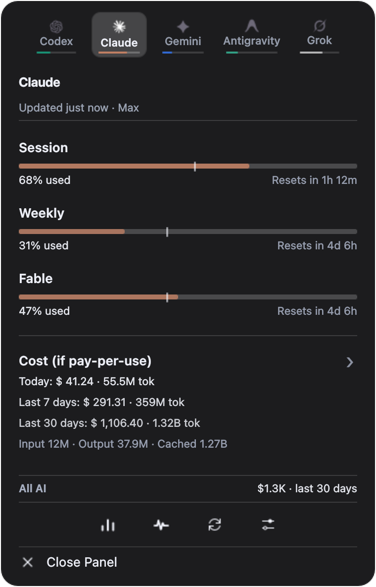
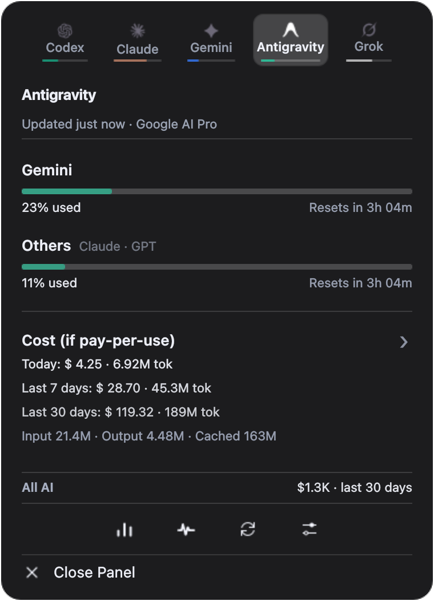
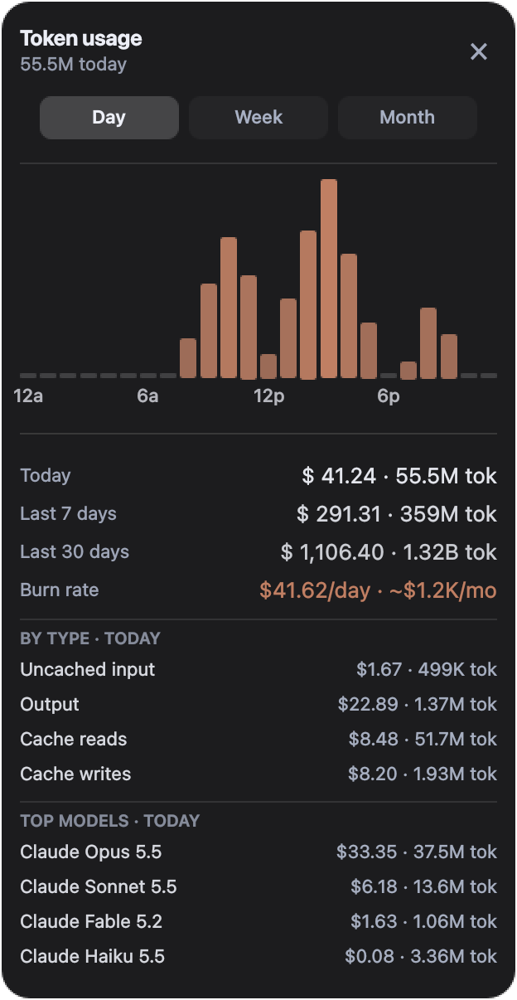
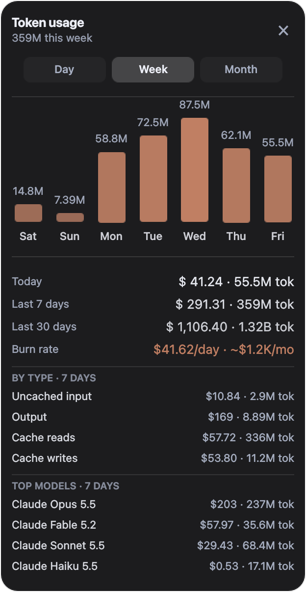
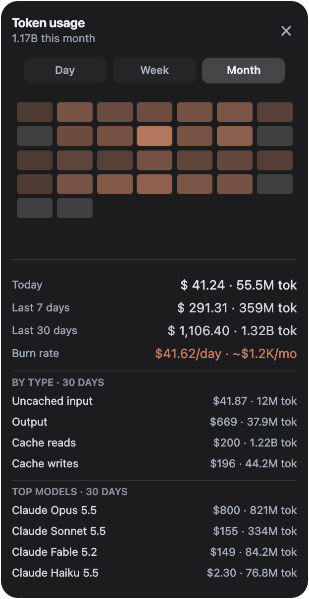
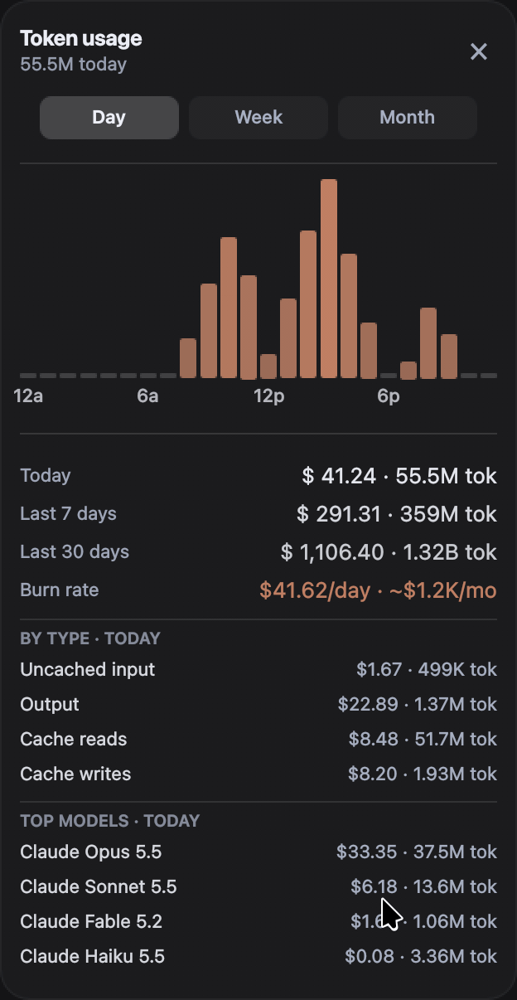

# TallyBar

[](https://github.com/DLANSAMA/TallyBarPlasmoid/actions/workflows/ci.yml)
[](https://github.com/DLANSAMA/TallyBarPlasmoid/releases/latest)
[](LICENSE)


A KDE Plasma 6 panel widget that shows how much of your AI coding assistants'
usage you have left — and what that usage would have cost at pay-per-use rates.

<p align="center">
  
  
</p>

## Why

Every AI coding tool meters you differently. Claude has a rolling session window
and weekly caps, plus separate ones for individual models; Codex has its own
session/weekly pair; Antigravity splits its quota between Gemini and everything
else; Grok bills by the week. Each hides that number behind a different CLI flag,
web page, or nothing at all — and none of them tell you what the tokens you just
burned would have cost on the API.

TallyBar puts all of it in the panel: one bar per limit, one number per bill.

Clicking the cost row opens a flyout with the spend graph — by hour, by day, or
as a month heat grid. Clicking any bar or day expands it into a per-model breakdown.

<p align="center">
  
  
  
</p>

<p align="center">
  
</p>

## What it shows

| Provider        | Quota / limits                                    | Where that comes from                                                  |
|-----------------|---------------------------------------------------|------------------------------------------------------------------------|
| **Codex**       | session window, weekly window, plan               | the `codex` CLI's app-server over JSON-RPC; chatgpt.com with your browser's session as fallback |
| **Claude**      | session window (not on Ultra), weekly window, per-model windows, plan | claude.ai, using your browser's existing session; else Claude Code's sign-in; plan read from disk |
| **Gemini**      | daily usage, Google One AI credit pool            | gemini.google.com and one.google.com, using your browser's existing session |
| **Antigravity** | 5-hour and weekly windows for Gemini and for Claude/GPT, plan | the local Antigravity language server, plus Google's Cloud Code API     |
| **Grok**        | the one weekly limit all Grok products share, split by product; plan and on-demand spend | xAI's billing service via the `grok` CLI's sign-in; else the CLI's log; the Grok Bot desktop app's sign-in adds plan and spend |

Each bar carries its reset countdown, which keeps counting between refreshes. Session and
weekly bars also show a pace marker and a forecast: `Pace: On pace · Lasts to reset`, or
`At this pace: runs out in 2h 10m`. A reading that could not be refreshed stays on screen
with its age (`Updated 3h ago (cached)`) instead of disappearing. Desktop notifications
fire when a limit passes a threshold you pick.

Cost is computed separately, from **local log files only** — the transcripts
each CLI already writes to `~/.claude` (plus `$CLAUDE_CONFIG_DIR` and the Claude
desktop app's sessions under `~/.config/Claude` and `~/.config/claude`), `~/.codex`,
`~/.gemini`, `~/.grok` and
Antigravity's trajectory databases. Tokens are priced against the
[LiteLLM](https://github.com/BerriAI/litellm) model catalog (fetched once and
cached on disk), which is why the heading reads *"Cost (if pay-per-use)"* — it
is what your usage *would* have cost on the API, not what you were charged.
Each request is priced on its own, at the rate in force on the day it happened. A model
that costs more for long prompts (Claude Haiku 5.5 past 100K tokens, GPT-5.5 past 272K)
is billed at the higher rate only for the requests whose prompt crosses that size. A
model with no exact price is billed at a neighbouring model's rate and named in the cost
section (`Estimated rate: …`). The **All AI** line at the bottom of every tab adds the
providers together.

## Requirements

- **KDE Plasma 6.0** or newer
- **Python 3.11** or newer — the backend uses `asyncio.TaskGroup` and
  `asyncio.timeout`, both new in 3.11
- Nothing else. The backend is standard-library only: no pip install, no
  virtualenv, no daemon.

Optional, per provider: KWallet for decrypting Chromium-family cookies, and
whichever CLIs and desktop apps you actually use. Every provider is independent — a
missing one shows a one-line message in its tab, never an error dialog.

## Install

Download `io.github.dlansama.tallybar.plasmoid` from the
[latest release](https://github.com/DLANSAMA/TallyBarPlasmoid/releases/latest) and
install it with the tool Plasma ships:

```bash
kpackagetool6 --type Plasma/Applet --install io.github.dlansama.tallybar.plasmoid
```

Or install from source:

```bash
git clone https://github.com/DLANSAMA/TallyBarPlasmoid.git
cd TallyBarPlasmoid
make install
```

Then right-click your panel → **Add Widgets…** → search for *TallyBar*.

`make install` wraps `kpackagetool6`; `make build` produces the same `.plasmoid`
package the release ships.

To update an existing install, `make upgrade` (or, with a downloaded package,
`kpackagetool6 --type Plasma/Applet --upgrade io.github.dlansama.tallybar.plasmoid`),
then restart the shell so Plasma drops its cached copy of the QML:

```bash
systemctl --user restart plasma-plasmashell.service
```

`make remove` uninstalls it, as does
`kpackagetool6 --type Plasma/Applet --remove io.github.dlansama.tallybar`.

## First run

The widget refreshes every 5 minutes by default and paints the last known values
immediately on cold start, so it is never blank while a fetch is in flight.

Each provider connects itself:

- **Codex** works as soon as the `codex` CLI is installed and signed in. TallyBar
  starts the CLI's own app-server for each reading; nothing has to be left running.
- **Grok** works as soon as the `grok` CLI has been signed in and used once. All
  Grok products (Grok, Grok Build, Grok Bot) share one weekly limit, so there is one
  Grok tab: the bar is read live with the CLI's sign-in, with the split by product
  under it; when that has expired, or the network is off, it comes from the CLI's own
  log files instead.
- **Antigravity** is read from its language server, which runs while Antigravity
  (or `agy`) is open. Plan and quota keep working from a cached token afterwards.
- **Claude** and **Gemini** use the session cookies already in your browser
  (Chrome, Chromium, Brave, Edge or Firefox, including Flatpak Firefox). If you are
  signed in to claude.ai or gemini.google.com in one of those, there is nothing to
  configure; if you are not, the tab shows a sign-in button that opens the right
  page. Chrome, Chromium, Brave and Edge encrypt their cookies with a key kept in
  KWallet, so the wallet has to be unlocked; the tab shows an **Unlock KWallet**
  button when it is not.
- **Claude** can also read Claude Code's own sign-in (`~/.claude/.credentials.json`)
  when the browser route has nothing: no cookie, a locked KWallet, or a rejected
  session. It is off until you turn on **Claude Code sign-in fallback** in Settings,
  because Anthropic's terms limit plan sign-in to its own apps. Once on, the Claude
  tab works without a browser session while Claude Code is signed in. The browser
  route stays first.
- **Grok Bot** adds its plan name and on-demand spend to the Grok tab through the
  sign-in the Grok Bot desktop app keeps: open the app and sign in once. That
  sign-in is encrypted with the Chromium Safe Storage key, so reading it needs
  KWallet, like the browser cookies. Without the Grok CLI, its weekly bar stands in
  for the Grok bar.

On a machine with none of these installed, the widget still starts and each tab says
what it is missing (`Antigravity isn't running — open it to read live session usage.`)
rather than failing. [Troubleshooting](#troubleshooting) lists the messages.

## Using it

**In the panel.** Click the icon to open the popup. Scroll or middle-click on it to
change what it shows: the selected provider's bars, its reset countdown, its cost, or
its pace. Right-click for **Refresh**, and **Unlock KWallet** when the wallet is locked.
Hovering shows a summary tooltip.

**In the popup.** One tab per provider; a marked tab has a problem to look at. Clicking
the cost row opens the chart flyout. The footer has four buttons: the provider's usage
dashboard, its status page, refresh, and settings.

## Configuration

The sliders button in the popup footer opens the settings flyout:

| Setting | Choices |
|---|---|
| **Panel icon shows** | Bars, Reset, Cost or Pace |
| **Refresh every** | 1, 2, 5, 15 or 30 minutes |
| **Show providers** | which providers get a tab |
| **Opens on** | the tab the widget starts on |
| **Mute alerts** | silence notifications per provider |
| **Usage notifications** | on or off, with a **Test** button |
| **Alert when usage passes** | 80, 90, 95 and 100% |
| **Monthly budget** | off, $50, $100, $250, $500 or a custom amount |
| **Claude Code sign-in fallback** | off unless you turn it on (see [First run](#first-run)) |

Settings live in `~/.tallybar/config.json`; deleting it resets them. The rest of that
directory is the widget's own state. The cached snapshot and the parse caches are
rebuilt by the next refresh. The Antigravity token ledger, the monthly cost archive and
the Grok archive hold history that the tools' own logs may no longer contain, so
deleting those loses older totals.

## Troubleshooting

Each provider fails on its own, and its tab says why:

| The tab says | What it means | What to do |
|---|---|---|
| `Sign in to claude.ai in Chrome (Default), then refresh.` | No session cookie for that site in the named browser profile | Press the sign-in button, sign in, then refresh |
| `No supported browser profiles found — …` | No Chrome, Chromium, Brave, Edge or Firefox profile on this machine | Sign in to the site in one of those browsers |
| `KWallet is locked. Unlock it to read this provider's session cookies.` | The cookie key is in a locked wallet; a background refresh never prompts for it | Press **Unlock KWallet** in the tab or the right-click menu |
| `API rejected session cookies (401)`, `Google session signed out — …` | The browser session has expired | Sign in again in the browser, then refresh |
| `Claude Code sign-in expired; open Claude Code to renew it` | The sign-in fallback's token has lapsed | Open Claude Code, or sign in to claude.ai in a browser |
| `Codex isn't running — start the Codex app to read usage.` | The `codex` CLI was not found | Install the `codex` CLI and sign in |
| `Antigravity isn't running — open it to read live session usage.` | The Antigravity language server is not running | Open Antigravity or run `agy` |
| `No Grok usage found — …` | Neither the `grok` CLI nor the Grok Bot app is set up | Sign in to either one |
| `Updated 3h ago (cached)` | The last good reading is shown because a newer one could not be fetched | Usually clears on its own; for Grok, running `grok` renews its sign-in |
| `(paused: screen locked)` | Refreshes stop while the screen is locked | Nothing; it resumes on unlock |
| `Refresh failed, showing last values: …` | The whole refresh failed | Press refresh; if it persists, run the backend by hand (below) |
| `Cost scan timed out — totals may be stale` | Reading the local logs took too long; the previous totals are kept | Nothing; the next refresh usually finishes |
| `Price list update failed — costs use cached rates` | The price catalog could not be downloaded | Nothing; the cached prices are used |

To see what the widget sees, run its backend the way the widget does:

```bash
python3 ~/.local/share/plasma/plasmoids/io.github.dlansama.tallybar/contents/code/backend.py --once --background --pretty
```

Each provider's `status` and `message` are in the output. Tokens and cookies are
scrubbed, but it still names your home directory and browser profiles: read it before
pasting it into an issue.

## How it works

The widget is two halves separated by a process boundary:

```
QML frontend                       Python backend
io.github.dlansama.tallybar/contents/ui/      io.github.dlansama.tallybar/contents/code/
  main.qml  ── Plasma5Support ───►  backend.py --once --background
  (owns all state)  DataSource      (prints one JSON snapshot, exits)
        ▲                                   │
        └────────── stdout JSON ────────────┘
```

There is no daemon and no socket. Every refresh runs `backend.py` once; it
gathers everything concurrently, prints a single JSON document, and exits. The
frontend `JSON.parse`s stdout and re-renders. That shape is deliberate — a
widget that can't hang is worth more than one that saves a process spawn, and it
makes the backend trivially testable and debuggable by hand:

```bash
# Exactly what the widget runs, but readable
python3 io.github.dlansama.tallybar/contents/code/backend.py --once --background --pretty

# Skip every remote call (local logs and language servers only)
python3 io.github.dlansama.tallybar/contents/code/backend.py --once --no-network --pretty

# Just the cost/token numbers
python3 io.github.dlansama.tallybar/contents/code/backend.py --cost
```

`backend.py` always prints parseable JSON, including on a fatal error — it falls
back to the last cached snapshot rather than exiting silently, because a crash
that prints nothing would blank the widget.

The contracts a change must not break — and the test that guards each one — are
in [`CLAUDE.md`](CLAUDE.md).

## Privacy and security

This widget reads credentials, so it is worth being explicit about what it does
with them:

- **Nothing is sent anywhere but the provider it belongs to.** There is no
  telemetry, no analytics, no update check. The hosts TallyBar requests are listed
  [below](#hosts-contacted).
- **Browser cookies are read, never kept.** The browser's own database is never
  opened directly (that would fight the browser for the lock). It is copied into
  a private `0700` directory under `$XDG_RUNTIME_DIR` — tmpfs, cleared at logout
  — with `O_NOFOLLOW`, read once, and deleted. Copies stranded by a killed
  process are swept on the next run.
- **Chromium-family cookies are decrypted through KWallet**, using the same
  key the browser itself uses. TallyBar never asks you for a password, and the
  background refresh never triggers a wallet-unlock prompt.
- **Every diagnostic string is scrubbed** for tokens, API keys, JWTs and session
  cookies before it can reach the snapshot, the UI, or a log.
- **Everything written to disk is written atomically at `0600`** under a `0700`
  parent — temp file, `fsync`, `os.replace` — and the files that matter carry a
  `.bak` mirror with corruption quarantine on load.
- **Requests that carry a bearer token refuse redirects.** CPython's redirect handler
  copies the `Authorization` header cross-origin; the Anthropic, Google, xAI and Cursor
  endpoints that receive one never legitimately redirect, so a `3xx` from one is treated
  as an attack and raised instead of followed. Cookie requests follow HTTPS redirects
  only.
- **Refreshes stop while the screen is locked**, and do not overwrite the cached
  snapshot when they do.

### Hosts contacted

| Host | For |
|---|---|
| `claude.ai` | Claude limits, with your browser session |
| `api.anthropic.com` | Claude limits, only with the Claude Code sign-in fallback turned on |
| `gemini.google.com`, `one.google.com` | Gemini usage and the Google One AI credit pool |
| `chatgpt.com` | Codex limits, only when the `codex` CLI gives none |
| `cloudcode-pa.googleapis.com`, or the `daily-` channel host Antigravity itself uses | Antigravity plan and quota |
| `oauth2.googleapis.com` | renewing Antigravity's own sign-in |
| `cli-chat-proxy.grok.com` | xAI's billing service, for the Grok bar |
| `api2.cursor.sh` | the dashboard service the Grok Bot app itself uses |
| `raw.githubusercontent.com` | the price catalog (no credentials sent) |

A request that carries cookies follows a redirect only to another HTTPS address, so a
signed-out Google page can lead to `accounts.google.com`. The `codex` CLI and the
Antigravity language server are local processes that make their own calls.

To report a security issue privately, see [SECURITY.md](SECURITY.md).

## Development

The runtime needs nothing installed; `.venv` holds the test and lint tools only.

```bash
python3 -m venv .venv && .venv/bin/pip install -r requirements.txt

make              # list the targets
make test         # the pytest suite
make lint         # pyflakes (what CI runs)
make check        # flake8 + Qt6 qmllint (fails on QML errors) + mypy
make preview      # load a UI component in a standalone window, no Plasma needed
make screenshots  # re-render docs/screenshots/ (PNGs + demo GIF) offscreen from this machine's live usage; MOCK=1 uses the mock fixture
make render-baselines  # re-render the mock-fixture PNGs the render tests compare against
make pot          # regenerate the translation template after changing i18n() strings
make build        # package io.github.dlansama.tallybar.plasmoid
```

### Adding a provider

TallyBar can't support a provider until someone has seen what it actually
returns, and no maintainer holds a subscription to every AI coding tool. So
captures are cheap to produce and worth contributing:

```bash
python3 tools/capture_provider.py copilot     # or: cursor
```

It reads the credential that tool already stored locally, makes one request,
scrubs the response through the same `scrub_credentials` the backend uses, and
writes a `0600` file. It uploads nothing. Free tiers are enough — GitHub Copilot
Free and Cursor's Hobby plan both yield a real response shape, which is the part
that can't be guessed.

Scrubbing is best-effort: read the file before attaching it to an issue.

The arithmetic lives in modules that don't reach the network — `parsers.py` is
pure (payload in, limit rows out) and the `accounting/` package does token and cost maths
against local files only. That is what most of the test suite exercises. The UI
can be run without Plasma — see
[`tools/preview/README.md`](tools/preview/README.md).

CI runs lint, type-checking, packaging, and tests across Python 3.11–3.13 on every pull
request and every push to `main`; pushing a `v*` tag builds the `.plasmoid`, stamps the
version into `metadata.json`, generates `SHA256SUMS`, and attaches both to a GitHub
release. See [CONTRIBUTING.md](CONTRIBUTING.md) for the full contribution checklist.

## Known limitations

- **Linux/KDE only.** It is a Plasma 6 applet; there is no port to anything else.
- **Every reading except the `codex` CLI's own depends on unofficial endpoints** — the
  same ones the providers' own apps call, with your own session. They are not public APIs and
  can change without notice. When one does, that provider degrades to a status
  message and the others keep working.
- **The Claude Code sign-in route (once turned on) lasts as long as Claude Code's access token.**
  TallyBar sends the access token Claude Code keeps and never renews it; it lapses
  about eight hours after Claude Code last did. Past that the Claude tab asks you to
  open Claude Code (which renews it), or uses the browser route or the
  [statusLine capture](integrations/README.md) if you have them.
- **Grok's live bar lasts as long as the CLI's sign-in.** TallyBar uses the access
  token the `grok` CLI keeps in `~/.grok/auth.json` and never renews it; it lapses
  about six hours after the CLI last did. After that the bar shows xAI's last reading
  from the CLI's log, which only updates when the CLI starts, and marks it "(cached)"
  past an hour. Running `grok` renews its sign-in.
- **Grok Bot has no cost history.** Its share of the weekly limit shows in the Grok bar,
  but it keeps no local token log, so the Grok tab's cost card covers Grok Build only.
- **English only.** The strings are marked for translation and a template is in `po/`,
  but no translation ships.
- **Costs are estimates.** They are list prices applied to locally logged token
  counts. Treat them as a sense of scale, not a bill. An Antigravity CLI session
  known only from its status-line total is billed at the base rate, since no single
  request's prompt size survives.

## Prior art

The idea comes from [CodexBar](https://github.com/steipete/CodexBar) by Peter
Steinberger — the same job, done as a macOS menu-bar app. TallyBar is an
independent implementation for Plasma with its own backend, and it borrows
CodexBar's monochrome provider marks under that project's MIT license.

## License

MIT — see [LICENSE](LICENSE). Provider logos are the trademarks of their
respective owners and are bundled only to identify each provider; the bundled
MIT-licensed artwork carries its upstream copyright notice. Both are recorded in
[`io.github.dlansama.tallybar/NOTICE`](io.github.dlansama.tallybar/NOTICE).
